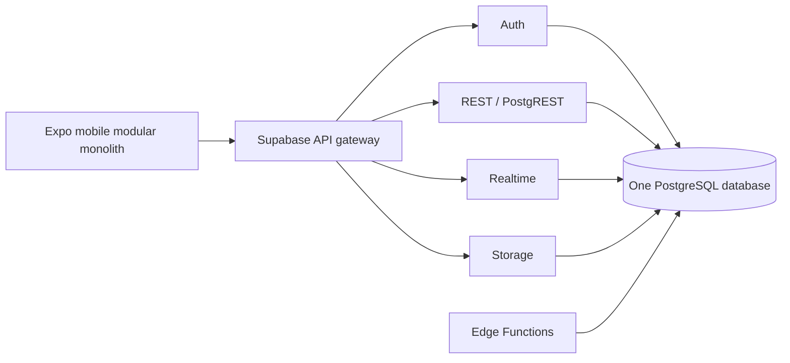

# Docker development setup

## Architecture classification

BiteLoop is a **modular monolith backed by Supabase**.

- The Expo application is one deployable mobile client.
- PostgreSQL is the single source of truth.
- Supabase exposes Auth, REST, Realtime, Storage, and Edge Functions around that
  database.
- Product areas such as check-ins, restaurants, reviews, circles, pricing, and
  recommendations are code modules—not independently deployed services.

Supabase itself contains several internal services, but consuming a managed
backend does not make the BiteLoop application a microservices architecture.
BiteLoop does not independently deploy, version, and operate a check-in service,
review service, map service, and recommendation service.

This is the appropriate starting point: the domain has many relationships and
transactions, while the product has not yet demonstrated traffic that requires
independent scaling. A module can be extracted later if measurements show a
clear need—for example, CPU-heavy image processing or recommendation jobs.



## What Docker is used for

Docker provides reproducible development tooling; it does not build or emulate
the native iOS application.

1. The repository `Dockerfile` runs Node, Expo CLI, and the Metro bundler.
2. `compose.yaml` starts the mobile development container with source mounts.
3. The Supabase CLI starts its official local Docker stack: PostgreSQL, Auth,
   Storage, Realtime, REST API, Studio, and supporting services.
4. Native apps still run in Expo Go, a development build, Android Emulator, iOS
   Simulator, or a physical device.
5. Production Android and iOS binaries are produced by EAS or native build
   tools—not by this Dockerfile.

## Prerequisites

- Docker Desktop with the Compose plugin
- Native Supabase CLI in the repository's ignored `.tools` directory
- At least 7 GB of free memory available to Docker is recommended for the full
  local Supabase service suite plus Metro

Application dependencies are installed only in the container's `node_modules`
volume. Node.js and npm are not required on the host.

## Supabase CLI on Windows

Supabase has already been initialized in this repository. The verified native
Windows CLI is stored in the ignored `.tools` directory, so using it does not
require host Node.js. Start the local stack with:

```powershell
.\.tools\supabase.exe start --exclude vector
```

The optional Vector log collector is excluded because it otherwise expects
Docker Desktop's unauthenticated TCP API on port 2375. Do not enable that
insecure endpoint. Database, Auth, REST, Realtime, Storage, Edge Runtime, and
Studio remain enabled.

Supabase Studio will normally be available at `http://127.0.0.1:54323` and the
local API at `http://127.0.0.1:54321`. Save the publishable/anonymous key printed
by `supabase start` in `.env.docker`; never put the service-role or secret key in
the mobile application.

Do not expose the local Supabase ports to the public internet.
The CLI binds local services to all interfaces for device testing, so use only a
trusted private network and keep Windows Firewall enabled. Studio has no local
authentication and must not be port-forwarded.

## Start mobile development

Create the local Docker environment file:

```bash
cp .env.docker.example .env.docker
```

Set `EXPO_PACKAGER_HOSTNAME` in `.env.docker` to the computer's current LAN IP.
Expo uses this address in its QR code so a physical iPhone can reach Metro. The
Compose configuration intentionally refuses to start when this value is absent,
preventing a QR code that points to Docker's unreachable private address.

Then start Metro:

```bash
docker compose --env-file .env.docker up --build mobile
```

Source files under `apps/mobile/src` are mounted into the container, so edits
are available to Metro without rebuilding the image. Rebuild after changing a
package manifest.

## Phone and emulator networking

`localhost` always refers to the device on which code is running:

- Inside the mobile container, the host is `host.docker.internal`.
- On a physical phone, use the development computer's LAN address, such as
  `http://192.168.1.20:54321`.
- Android Emulator commonly reaches the host via `10.0.2.2`.
- iOS Simulator on macOS can generally reach host services via `localhost`.

Set `EXPO_PUBLIC_SUPABASE_URL` to an address reachable by the actual app runtime.
Both the phone and development computer must be on a network that permits the
connection. Do not use an unrestricted public tunnel for the local Supabase
stack.

## Useful commands

```bash
docker compose --env-file .env.docker up mobile
docker compose logs -f mobile
docker compose down
docker compose run --rm mobile npm run typecheck
docker compose run --rm mobile npx --yes eas-cli build --platform all --profile preview
.\.tools\supabase.exe status
.\.tools\supabase.exe stop
```

Stopping containers preserves local Supabase volumes by default. Avoid commands
that delete volumes unless losing local development data is intentional.

## Production decision

Use managed Supabase for the initial production release. Do not treat this local
Docker setup as a production self-hosting configuration. Production self-hosting
adds responsibility for secrets, upgrades, security, backups, high availability,
monitoring, and disaster recovery.
