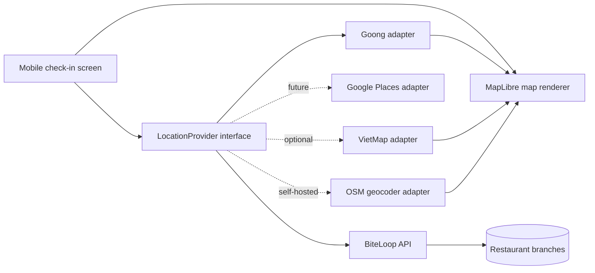
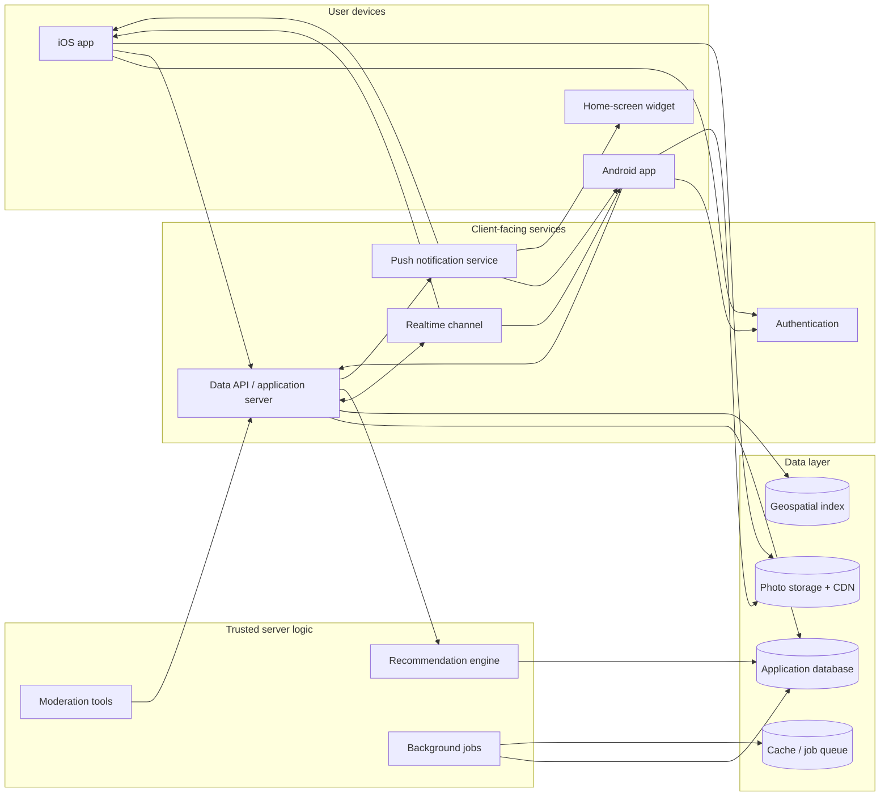
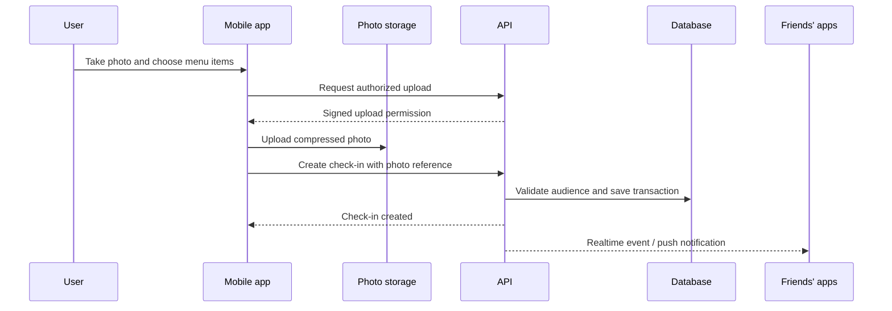
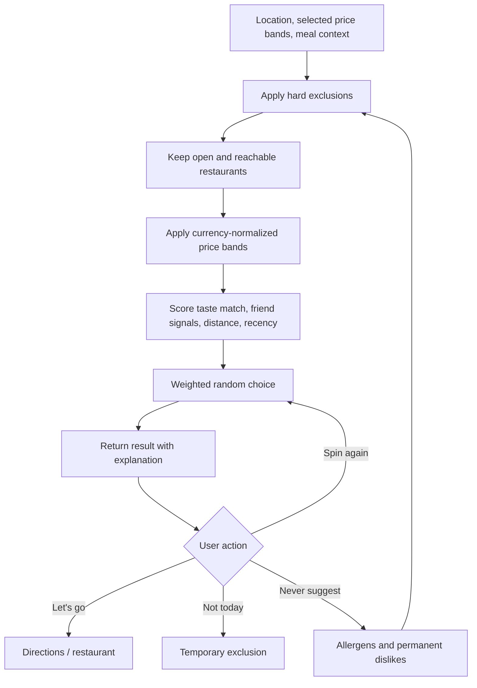
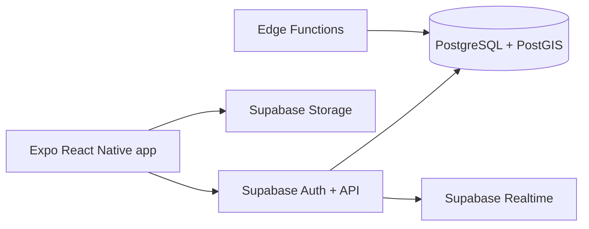
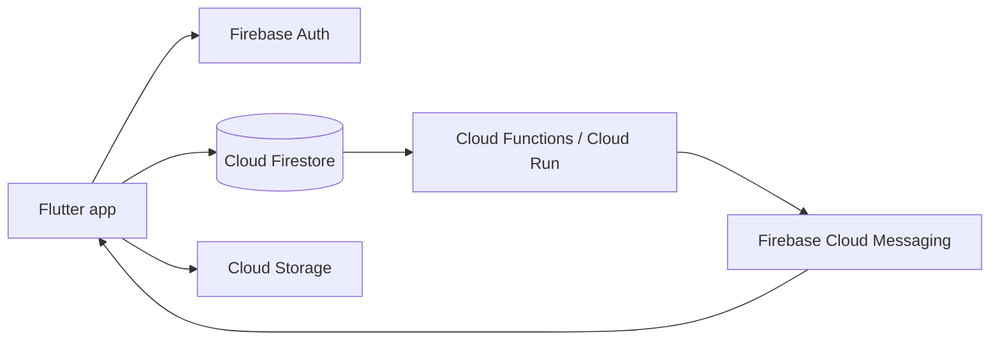
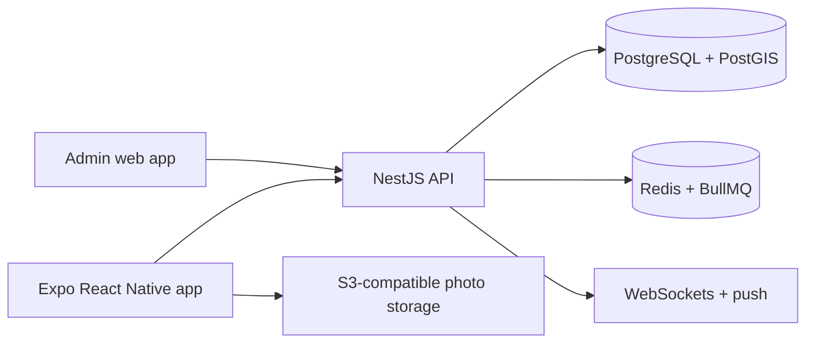
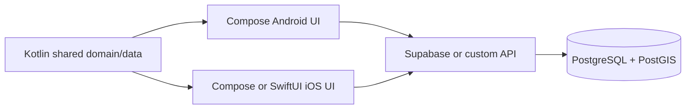

# BiteLoop technology and architecture options

This document is a decision guide, not a locked technology prescription. Every
option below can produce both iOS and Android applications. The repository is
currently scaffolded with **Option A: Expo React Native**, because it is the
least expensive option to prototype and is reversible at this stage.

With Expo and Supabase selected, BiteLoop starts as a **modular monolith using a
managed backend**, not as application-owned microservices. See
[`DOCKER.md`](./DOCKER.md) for the classification and local container workflow.

## 1. What the system needs

BiteLoop is more than a photo feed. Its stack must support:

- iOS and Android from a manageable codebase.
- Camera and photo-library access.
- Restaurant locations and nearby searches.
- Private social circles and per-post visibility.
- Menu, dish, review, category, currency, and price-range data.
- Photo storage and delivery.
- Realtime reactions and group decision rooms.
- Push notifications and, later, home-screen widgets.
- Hard dietary exclusions before recommendation ranking.
- Background jobs for menu freshness and exchange rates.
- An administration and moderation interface later.

## 2. Vietnam map and restaurant-location options

Map display, place search, geocoding, and navigation are separate capabilities.
They should sit behind a `LocationProvider` interface so changing vendors does
not rewrite check-in screens or restaurant records.

### Location provider architecture

The provider returns a normalized object containing `provider`,
`providerPlaceId`, `name`, `formattedAddress`, `latitude`, `longitude`, and
optional phone/type data. BiteLoop creates its own stable `branchId` and stores
the external reference alongside it.

### Map Option 1 — Goong for Vietnam (preferred MVP)

| Goong capability | BiteLoop usage |
| --- | --- |
| Place Autocomplete | Suggest Vietnamese restaurant names and addresses as the user types. |
| Place Detail | Retrieve the selected place's exact coordinate and address. |
| Geocoding | Convert an address to coordinates or coordinates back to an address. |
| Map tiles | Display restaurant pins on a Vietnam-focused map. |
| Directions API or external URL | Estimate routes or open turn-by-turn navigation. |

Goong publishes a free allowance of approximately 30,000 REST API requests and
1,000 map loads per month, after which requests may be throttled or require a
paid plan. Treat those limits as provider configuration, monitor usage, and
cache only where the provider's terms allow.

**Advantages:** optimized for Vietnam, low-cost MVP, Vietnamese place search,
and a Google-like API model.  
**Tradeoffs:** smaller ecosystem than Google, quotas are not unlimited, and
provider coverage must be tested against real restaurants in the launch cities.

### Map Option 2 — VietMap

VietMap provides Vietnam-focused maps, geocoding, routing, and mobile SDKs. It
offers a free development API key for testing; production price and permissions
must be confirmed before launch.

**Advantages:** Vietnam-specific provider and native mobile/navigation options.  
**Tradeoffs:** “free development key” does not mean permanently free production
traffic. SDK integration and commercial terms should be evaluated with a proof
of concept.

### Map Option 3 — OpenStreetMap data + MapLibre

MapLibre is the open-source renderer inside the mobile app. OpenStreetMap is the
underlying open geographic dataset. A hosted or self-hosted tile service and
geocoder are still required.

**Advantages:** vendor independence, open data, customizable visual style, and
the ability to self-host later.  
**Tradeoffs:** the public OpenStreetMap tile server has no service guarantee and
does not permit bulk/offline downloading. The public Nominatim geocoder limits
heavy use to one request per second and explicitly forbids client-side
autocomplete. Therefore, public OSM services are suitable only for light
development—not BiteLoop production search. Production requires a compliant
hosted provider or self-hosted tiles and geocoding.

### Map Option 4 — Google Maps Platform

Google Places remains an optional premium adapter for coverage comparison or a
future fallback. It can provide place IDs, precise coordinates, autocomplete,
details, maps, and directions, but requires billing and carefully restricted
platform/server API keys.

### Map-provider comparison

| Criterion | Goong | VietMap | OSM + MapLibre | Google Maps |
| --- | :---: | :---: | :---: | :---: |
| Vietnam focus | 5 | 5 | 3–4 | 4 |
| Free MVP allowance | Yes, quota | Development/testing | Data yes; hosting no | Billing-based |
| Restaurant autocomplete | Yes | Available | Must host/buy service | Yes |
| Exact coordinates | Yes | Yes | Yes when POI exists | Yes |
| Vendor independence | 3 | 2 | 5 | 1 |
| Production operations | Low | Low | High if self-hosted | Low |

### Location security and cost rules

1. Mobile map-tile keys and server geocoding keys are separate.
2. Server REST keys never use an `EXPO_PUBLIC_` variable or ship in the app.
3. Restrict each key by API, application, domain, or server IP wherever the
   provider supports it.
4. Search is debounced and autocomplete sessions are reused to reduce cost.
5. Only request fields needed for branch selection.
6. Store exact coordinates and the provider ID, but also assign an internal
   BiteLoop branch ID.
7. Device GPS is used only with permission and is never treated as the
   restaurant's coordinate.
8. Display required provider/OpenStreetMap attribution on every map.

## 3. Platform-neutral system architecture

The same logical architecture applies regardless of the languages and vendors
selected:

### Typical check-in flow

Photos should upload directly to object storage using short-lived authorization.
The database stores metadata and access rules, not the image binary itself.

### “Pick for Me” flow

## 4. Mobile application options

### Option A — Expo React Native + TypeScript

**What each part does**

| Technology | Usage in BiteLoop |
| --- | --- |
| React Native | Renders native iOS and Android screens from shared component code. |
| Expo | Manages native projects and provides camera, image, location, notifications, deep-link, and build integrations. |
| TypeScript | Defines safe models for restaurants, menu items, reviews, money, and filters. |
| Expo Router | Maps files to native screens and handles tab, stack, modal, and deep-link navigation. |
| TanStack Query | Fetches and caches server data; manages retry, refresh, invalidation, and offline transitions. |
| React Hook Form | Controls check-in and review forms without rerendering every field unnecessarily. |
| Zod | Validates form and API data at runtime using rules shared across the TypeScript codebase. |
| Expo Image Picker | Opens the native camera or photo library for check-in photos. |
| Expo Location | Obtains the user's approximate position, with permission, to bias nearby restaurant search. |
| MapLibre React Native | Displays the selected Goong, VietMap, or OSM-derived map style and exact branch pins. |
| Expo SecureStore | Stores sensitive device-side tokens using native secure storage. |
| EAS Build | Builds and signs Android and iOS binaries in the cloud, including iOS builds initiated from Windows. |

**Advantages**

- Fastest path with a TypeScript/web-oriented team.
- Large React ecosystem and high code sharing.
- EAS reduces native build and signing work.
- Easy to add a TypeScript admin web application later.
- The current repository already contains a working-compatible structure.

**Tradeoffs**

- Home-screen widgets require platform-specific native extensions or a
  compatible Expo module; they are not ordinary React Native screens.
- Advanced camera, maps, or background behavior may require a development build
  and native configuration rather than Expo Go.
- Framework upgrades must follow Expo/React Native compatibility versions.

**Choose this when:** the priority is a fast MVP, the team knows JavaScript or
TypeScript, and mostly shared UI is desirable.

### Option B — Flutter + Dart

**What each part does**

| Technology | Usage in BiteLoop |
| --- | --- |
| Flutter | Draws a consistent shared UI on iOS and Android. |
| Dart | Implements UI, domain models, and client business logic. |
| Riverpod or Bloc | Holds authentication, check-in drafts, filters, and application state. Riverpod is simpler for a small team; Bloc is more prescriptive. |
| GoRouter | Handles tabs, protected routes, deep links, and navigation. |
| Dio | Calls backend HTTP APIs and implements interceptors and upload progress. |
| Freezed + json_serializable | Generates immutable Dart models and JSON conversion. |
| image_picker / camera | Captures or selects check-in photos. |
| geolocator | Retrieves device position for nearby restaurant discovery. |
| flutter_secure_storage | Stores tokens in iOS Keychain and Android encrypted storage. |
| Codemagic or native CI | Builds and distributes both platform binaries. |

**Advantages**

- Very consistent custom visuals and animation across platforms.
- Strong compiler and predictable widget system.
- Good option for a highly designed, animation-heavy consumer application.

**Tradeoffs**

- Requires Dart expertise and a separate stack from a TypeScript admin/backend.
- Some newest native SDK capabilities require writing Swift and Kotlin plugins.
- App binary and fully custom rendering may be heavier than native controls.

**Choose this when:** consistent custom visuals matter more than sharing skills
with a web team, or the team already knows Flutter/Dart.

### Option C — Kotlin Multiplatform + Compose Multiplatform

**What each part does**

| Technology | Usage in BiteLoop |
| --- | --- |
| Kotlin Multiplatform | Shares domain logic, networking, storage, and recommendation rules between Android and iOS. |
| Compose Multiplatform | Optionally shares the actual screen UI across both platforms. |
| Ktor Client | Makes typed API calls from shared Kotlin code. |
| Kotlin Serialization | Converts API payloads into shared models. |
| SQLDelight | Provides a typed local SQL database for offline check-ins and cached menus. |
| Coroutines and Flow | Handles asynchronous work and reactive state streams. |
| Swift/SwiftUI interop | Implements iOS-specific widgets, system integrations, or an entirely native iOS UI if desired. |

**Advantages**

- Strong type safety and excellent Android integration.
- Can share only business logic while preserving fully native SwiftUI on iOS,
  or share UI with Compose.
- Good long-term control for complex native features and offline behavior.

**Tradeoffs**

- Highest setup and staffing complexity of these three mobile options.
- iOS builds still require Xcode/macOS somewhere in the delivery pipeline.
- Platform-specific APIs may require separate implementations and expertise.
- Smaller cross-platform library ecosystem than React Native or Flutter.

**Choose this when:** the team has strong Kotlin/native experience, native
control is strategically important, and a longer initial development period is
acceptable.

### Mobile comparison

Scores are relative for BiteLoop: 5 is most favorable.

| Criterion | Expo React Native | Flutter | Kotlin Multiplatform |
| --- | :---: | :---: | :---: |
| MVP speed | 5 | 4 | 2 |
| Shared iOS/Android UI | 5 | 5 | 3–5, depending on UI strategy |
| Custom visual consistency | 4 | 5 | 4 |
| Native platform control | 3 | 3 | 5 |
| TypeScript/web skill reuse | 5 | 1 | 1 |
| Native mobile skill reuse | 3 | 2 | 5 |
| Library ecosystem | 5 | 4 | 3 |
| Windows-to-iOS cloud workflow | 5 with EAS | 4 with CI | 3 with CI |
| Expected initial cost | Low | Low–medium | High |

## 5. Backend options

The mobile choice does not force the backend choice. All three mobile options
can call any backend below.

### Backend 1 — Supabase

**What each part does**

| Service | Usage in BiteLoop |
| --- | --- |
| PostgreSQL | Stores users, circles, restaurants, branches, menus, reviews, exclusions, and check-ins. |
| PostGIS | Finds branches and dishes within a geographic radius. |
| Supabase Auth | Handles email, social, and token-based authentication. |
| Row Level Security | Prevents unauthorized reads of private check-ins and circle content at the database level. |
| Storage | Stores check-in photos and menu images in private buckets. |
| Realtime | Delivers new check-ins, reactions, and decision-room changes. |
| Edge Functions | Protects secrets and runs integrations such as exchange rates or moderation services. |

**Advantages:** fastest relational backend, little infrastructure work, SQL is a
natural fit for BiteLoop's interconnected data, and PostGIS handles nearby
searches.

**Tradeoffs:** business logic can become split among mobile code, SQL functions,
policies, and Edge Functions unless boundaries are enforced. Vendor-specific
realtime and auth APIs create some migration work.

**Choose this when:** shipping the MVP quickly with a small team is the priority.

### Backend 2 — Firebase

**What each part does**

| Service | Usage in BiteLoop |
| --- | --- |
| Firebase Authentication | Manages users and identity providers. |
| Cloud Firestore | Stores realtime check-ins, circles, reactions, and decision rooms as documents. |
| Cloud Storage | Stores food and menu photos. |
| Cloud Functions / Cloud Run | Runs trusted recommendation, moderation, and integration logic. |
| Firebase Cloud Messaging | Sends Android and iOS push notifications. |
| Crashlytics and Analytics | Reports crashes and measures feature usage with appropriate consent. |
| App Check | Reduces abuse by checking that requests originate from genuine application instances. |

**Advantages:** mature mobile SDKs, excellent realtime/offline behavior,
notifications and analytics in one ecosystem, and especially smooth Flutter
integration.

**Tradeoffs:** Firestore is document-oriented. Menus, per-dish metrics, group
constraints, and geospatial queries require denormalization and more deliberate
data modeling. Query-based billing and vendor coupling should be monitored.

**Choose this when:** offline/realtime mobile behavior is the top priority, the
team prefers NoSQL, or Flutter + Firebase expertise already exists.

### Backend 3 — NestJS API + PostgreSQL

**What each part does**

| Technology | Usage in BiteLoop |
| --- | --- |
| NestJS | Hosts explicit REST or GraphQL endpoints and organizes logic into TypeScript modules. |
| PostgreSQL + PostGIS | Stores relational and geospatial application data. |
| Prisma or Drizzle | Provides typed database access and migrations. Prisma is more batteries-included; Drizzle is closer to SQL. |
| Redis | Caches popular feeds, enforces rate limits, and backs temporary decision-room state. |
| BullMQ | Runs photo processing, notifications, exchange-rate refresh, and menu freshness jobs. |
| S3-compatible storage | Stores images independently from the API servers. |
| WebSocket gateway | Delivers reactions, check-ins, and group-room updates. |
| Managed auth or Passport | Verifies Apple, Google, email, and refresh-token identities. |

**Advantages:** maximum control, clear place for complex recommendation logic,
portable infrastructure, strong TypeScript sharing with Expo and an admin web
application.

**Tradeoffs:** requires deployment, observability, backups, security patching,
queues, storage policies, and more backend engineering before product features
can ship.

**Choose this when:** backend control, custom integrations, predictable service
boundaries, or future scale justify the additional engineering effort.

### Backend comparison

| Criterion | Supabase | Firebase | NestJS + PostgreSQL |
| --- | :---: | :---: | :---: |
| MVP speed | 5 | 5 | 2 |
| Relational menu/review model | 5 | 2 | 5 |
| Nearby/geospatial querying | 5 | 2 | 5 |
| Realtime and offline mobile | 4 | 5 | 3, must be built |
| Infrastructure control | 3 | 2 | 5 |
| Operational workload | Low | Low | High |
| Complex recommendation logic | 3 | 3 | 5 |
| Ease of migration away | 3 | 2 | 5 |

## 6. Complete stack combinations

### Combination A — Fastest MVP

**Stack:** Expo React Native + Supabase + EAS.  
**Best for:** one to four developers validating the product.  
**Main risk:** application rules becoming scattered across client code and
database functions. Use repository interfaces and documented database policies.

### Combination B — Google/mobile ecosystem

**Stack:** Flutter + Firebase + Cloud Functions/Run.  
**Best for:** teams already using Dart/Flutter that prioritize realtime and
offline behavior.  
**Main risk:** the relational menu and review model becoming duplicated across
Firestore documents.

### Combination C — TypeScript with backend control

**Stack:** Expo React Native + NestJS + PostgreSQL/PostGIS + Redis + S3.  
**Best for:** a funded team expecting complex recommendations, moderation, and
integrations.  
**Main risk:** spending engineering time on infrastructure before validating
whether people retain the app.

### Combination D — Native-control investment

**Stack:** Kotlin Multiplatform, Compose/SwiftUI, and either Supabase or a custom
API.  
**Best for:** a Kotlin/native team treating widgets, offline capability, and
deep OS integration as core differentiators.  
**Main risk:** slowest MVP and hardest staffing profile.

## 7. Shared decisions independent of stack

These rules should remain true whichever combination is selected:

1. Store money as an integer minor-unit amount and ISO 4217 currency code. VND
   has no fraction, so `150000 VND` is stored as `150000`, while `$12.50` is
   stored as `1250 USD`.
2. Preserve a restaurant's original price. Converted prices are estimates tied
   to a dated exchange rate.
3. Apply allergies and hard dietary exclusions before scoring or randomness.
4. Give restaurant branches separate IDs and coordinates.
5. Store photos in object storage and metadata in the database.
6. Enforce privacy on the server/database, not only by hiding UI.
7. Keep screens behind repository interfaces so backend changes do not rewrite
   the presentation layer.
8. Start the recommendation engine as deterministic filtering plus weighted
   random selection. Machine learning is unnecessary until enough real usage
   data exists.
9. Access maps and place search through an application-owned provider interface;
   default to Goong for the Vietnam MVP and retain provider-independent branch
   identifiers.

## 8. Selection guide

Choose based on the strongest constraint:

- **Need to validate quickly with the smallest team:** Expo + Supabase.
- **Team already specializes in Flutter/Dart:** Flutter + Firebase or Supabase.
- **Need TypeScript throughout but require backend ownership:** Expo + NestJS.
- **Team specializes in native Android/Kotlin and accepts higher initial cost:**
  Kotlin Multiplatform + PostgreSQL backend.
- **Unsure:** retain the current Expo scaffold, implement one end-to-end mocked
  check-in, and postpone the backend choice. The mobile repository boundary is
  designed to permit this.

The current Expo scaffold is a provisional implementation, not an irreversible
decision. Changing the mobile framework later would replace `apps/mobile`;
changing the backend later should affect repository adapters rather than screen
components.
